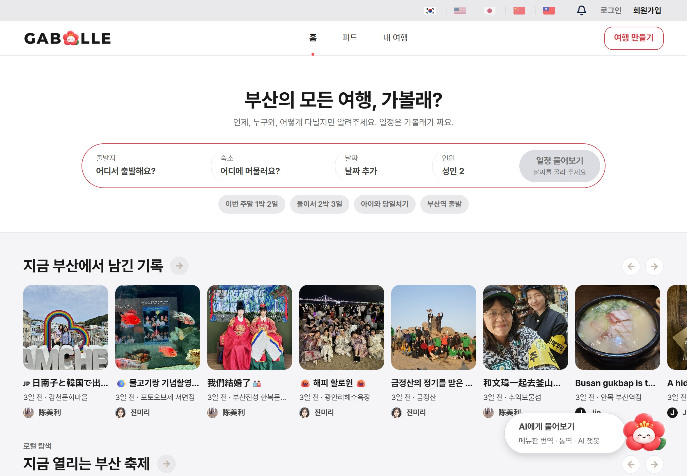
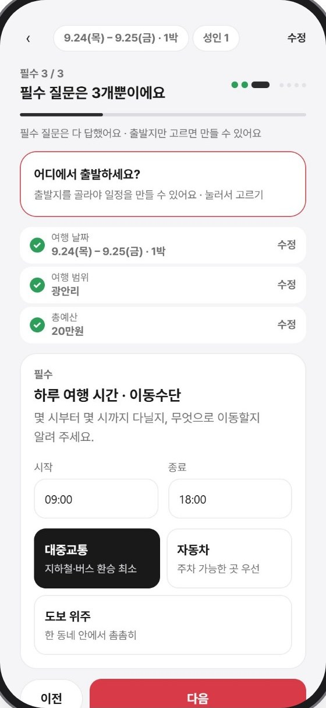
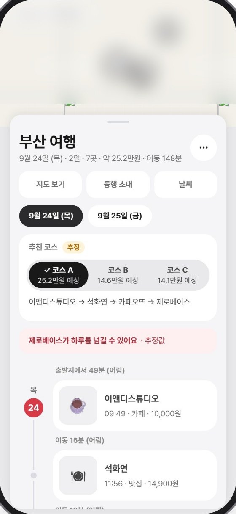
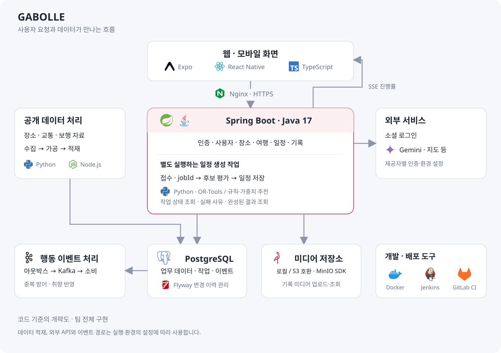

<p align="center">
  
</p>

# GABOLLE · 가볼래

**취향과 이동 조건에 맞춰 부산 여행을 계획하고, 여행 중에도 일정을 이어 가는 서비스**

가볼래는 날짜, 동행, 관심사와 이동 조건을 입력하면 부산의 장소와 여행 코스를 추천하는 웹·모바일 서비스입니다. 코스를 고른 뒤에는 지도와 시간표로 일정을 확인하고, 여행 중 순서를 바꾸거나 방문 기록을 남길 수 있습니다. 외국인 여행자를 위한 다국어 화면과 AI 여행 도우미도 함께 제공합니다.

SSAFY 15기 특화 프로젝트 · 6인 팀

## 영상 포트폴리오

[▶ GABOLLE 영상 포트폴리오: TRIP TO BUSAN](https://youtu.be/4VxillngQsY)

## 서비스 화면



홈에서 여행 기록과 축제를 둘러보고, 원하는 조건으로 새 여행을 만들 수 있습니다. 아래 이미지는 팀 발표 자료에 사용한 서비스 화면입니다.

## 담당 역할

백엔드를 중심으로 회원가입과 소셜 로그인, 여행·일정 생성의 기본 흐름, 기록·피드와 공유 기능을 구현했습니다. 이후 화면과 서버의 요청 형식, 인증 설정과 데이터 조건이 맞지 않아 생긴 문제를 추적하고 수정했습니다.

| 영역 | 직접 담당한 작업 |
| --- | --- |
| 인증 | 이메일·소셜 로그인, JWT 인증과 세션 관리, 웹·모바일의 토큰 갱신 경로 구현 |
| 여행·추천 | 여행 조건 저장, 일정 생성 작업의 접수·상태·결과 조회와 초기 규칙 기반 추천 연결 |
| 기록·공유 | 여행 기록 작성·조회·수정·삭제, 피드·팔로우, 동행 초대와 여행 공유·복제 기능 구현 |
| 연동·문제 해결 | 화면과 API의 입력 계약, 배포 설정과 DB 스키마를 대조하며 기능 연결 문제 수정 |

추천 데이터 수집, 대중교통 경로 계산과 이후 추천 품질 개선 등은 팀이 함께 확장한 구현입니다. 아래 기능과 시스템 구성은 프로젝트 전체를 설명합니다.

## 주요 기능

| 기능 | 설명 |
| --- | --- |
| 조건에 맞는 여행 계획 | 날짜, 출발지, 동행, 관심사, 이동 수단과 접근성·식단 조건을 반영한 장소·코스 추천 |
| 지도와 일정 확인 | 코스 후보 비교, 일자별 방문 순서와 이동 구간 확인, 일정 순서 변경 |
| 여행 중 일정 관리 | 방문 진행 상태 기록, 장소 교체와 일정 재계획 |
| AI 여행 도우미 | 자연어 여행 상담, 메뉴판 인식·번역 등 여행 중 필요한 도구 제공 |
| 여행 기록과 공유 | 사진·동영상 기록, 피드·팔로우, 동행 초대와 여행 공유 |
| 다국어 이용 | 여러 언어의 화면과 장소 정보로 부산 여행 탐색 지원 |

### 여행 조건에서 일정까지

<table>
  <tr>
    <th width="33%">여행 조건 입력</th>
    <th width="33%">코스 후보 확인</th>
    <th width="33%">여행 중 일정</th>
  </tr>
  <tr>
    <td></td>
    <td></td>
    <td></td>
  </tr>
</table>

추천 조건을 입력하고 코스 후보를 고른 뒤, 여행 중에는 다음 방문지와 남은 일정을 확인합니다. 추천에 필요한 정보가 확인되지 않은 장소는 안내를 함께 표시합니다.

### AI 도우미와 여행 기록

<table>
  <tr>
    <th width="33%">AI 여행 도우미</th>
    <th width="33%">여행 중 도구</th>
    <th width="33%">여행 기록 피드</th>
  </tr>
  <tr>
    <td></td>
    <td></td>
    <td></td>
  </tr>
</table>

## 시스템 구성



- **화면과 API**: Expo·React Native로 웹과 모바일 화면을 구성하고, Spring Boot가 인증, 장소, 여행과 기록 요청을 처리합니다.
- **일정 생성**: 오래 걸리는 계산은 작업 번호를 발급해 별도로 실행합니다. 규칙·가중치로 후보를 평가하고 Python·OR-Tools를 사용하는 일정 최적화 경로와 연결합니다.
- **진행 상태**: SSE로 서버의 진행률을 화면에 전달하고, 작업 상태와 완성된 결과를 별도로 조회합니다. SSE는 연결을 열어 둔 채 서버가 상태를 보내는 방식입니다.
- **데이터와 파일**: PostgreSQL에 사용자·장소·여행·일정을 저장하고, Flyway로 DB 변경 이력을 관리합니다. 기록의 사진·동영상은 로컬 또는 S3 호환 저장소를 사용합니다.
- **행동 이벤트**: 업무 변경과 함께 DB에 이벤트를 남기는 아웃박스 구조를 사용합니다. 별도 전송 작업과 Kafka 소비 경로에서 중복 처리를 막고 취향 반영을 이어 갑니다.
- **외부 연동**: 소셜 인증과 Gemini 기반 여행 도우미를 연결하고, 공개 장소·교통 자료를 수집·가공해 추천과 경로 조회에 사용합니다.

### 백엔드에서 고려한 점

| 상황 | 처리 방식 |
| --- | --- |
| 여행 생성 요청이 재전송됨 | 같은 요청을 구분하는 `Idempotency-Key`로 중복 생성을 방어 |
| 일정 계산에 시간이 걸림 | 계산 접수와 완성을 분리하고 `jobId`로 진행·실패·결과를 조회 |
| 추천할 장소가 부족함 | 필요한 경우 탐색 범위를 넓히고, 넓힌 범위와 사유를 응답에 포함 |
| 사용자가 일정 순서를 바꿈 | 일정 버전을 새로 만들고 이동 구간을 다시 계산 |
| 이벤트가 중복 전달됨 | 소비 처리 기록으로 이미 반영한 이벤트를 구분 |

## 기술 스택

| 영역 | 기술 |
| --- | --- |
| 프런트엔드 | TypeScript, React, React Native, Expo, Expo Router, TanStack Query |
| 백엔드 | Java 17, Spring Boot, Spring Security, Spring Data JPA |
| 데이터베이스 | PostgreSQL 16, Flyway |
| 추천·경로 | Java 규칙·가중치 기반 추천, Python, OR-Tools, RAPTOR 기반 대중교통 탐색 |
| AI 연동 | Google Gemini, 메뉴판 인식·번역, 자연어 여행 도우미 |
| 이벤트·저장소 | Apache Kafka, DB 아웃박스, S3 호환 저장소 |
| 인프라·검증 | Nginx, Docker Compose, Jenkins, GitLab CI, JUnit, Testcontainers, Playwright |

RAPTOR는 대중교통 노선망에서 환승 횟수와 도착 시간을 기준으로 경로를 탐색하는 알고리즘입니다.

## 저장소 구조

```text
GABBOLE/
├── frontend/                # Expo 기반 웹·모바일 화면
├── backend/                 # 인증, 장소, 여행, 추천과 기록 API
│   ├── solver/              # Python 일정 최적화
│   └── calibration/         # 관측값 기반 보정 작업
├── bigData/                 # 장소·교통·보행 데이터 수집과 가공
├── ai/                      # AI 관련 구현과 실험 자료
├── infra/personalization/   # 개인화 데이터 처리 환경
├── docs/                    # 설계·개발·운영 문서
└── exec/                    # 프로젝트 실행·이관 자료
```

## 로컬 실행

### 프런트엔드

Node.js와 npm이 설치된 환경에서 실행합니다.

```bash
git clone https://github.com/durian98/GABBOLE.git
cd GABBOLE/frontend
npm run setup:web
```

화면은 로컬 웹 개발 서버에서 열립니다. 실제 로그인·장소·여행 기능을 사용하려면 백엔드 주소와 지도·소셜 인증 등 외부 서비스 설정이 필요합니다. [환경변수 예시](frontend/.env.example)와 [프런트엔드 안내](frontend/README.md)를 참고하세요.

### 백엔드

저장소 루트에서 시작합니다. Docker와 Docker Compose가 필요합니다.

```bash
cd backend
cp .env.example .env
# .env의 DB 비밀번호와 JWT 비밀값 등 필요한 설정을 입력
docker compose up --build -d
```

인증정보와 외부 서비스 키는 직접 준비해야 하며 `.env`는 커밋하지 않습니다. 데이터 적재, Kafka 이벤트 경로와 외부 API는 각각의 설정이 필요합니다. 자세한 내용은 [백엔드 안내](backend/README.md)를 참고하세요.

## 관련 문서와 코드

- [서비스 기획·기능 명세](docs/gabolle/README.md)
- [프런트엔드 안내](frontend/README.md) / [백엔드 안내](backend/README.md)
- [장소·이동 데이터 흐름](bigData/dataflow.json)
- [일정 생성 작업 처리](backend/src/main/java/com/gabolle/backend/recommendation/application/RecommendationService.java)
- [규칙 기반 후보 생성](backend/src/main/java/com/gabolle/backend/recommendation/adapter/BaselineRecommendationEngine.java)
- [대중교통 경로 탐색](backend/src/main/java/com/gabolle/backend/route/transit/RaptorPlanner.java)
- [팀 개발 규칙](CONTRIBUTING.md)
- [README 이미지 출처와 구성 기준](docs/media/SOURCES.md)

이 저장소는 팀 GitLab의 `main@2d4f4f634`를 개인 포트폴리오로 보관한 사본입니다. 화면은 팀 발표 자료에서 가져왔으며 기준 커밋과 화면의 세부 버전은 다를 수 있습니다. 이 README는 코드와 기존 프로젝트 기록을 바탕으로 작성했으며, 현재 배포 서비스의 접속 상태나 운영 성능을 새로 검증한 결과는 아닙니다. 하위 문서에는 개발 당시의 설계·실험 기록도 포함되어 있습니다.
